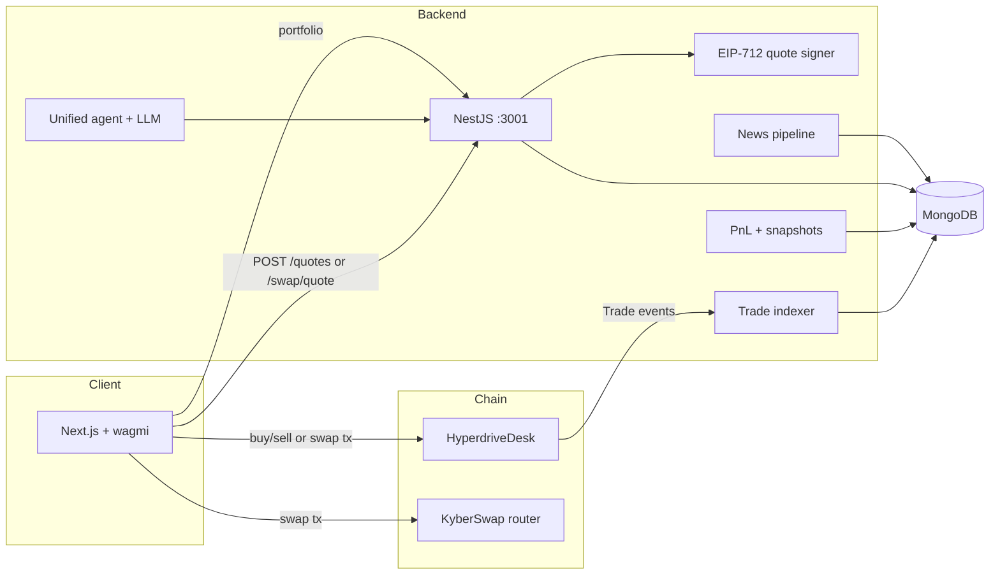

# HyperDrive

**Trade tokenized equities on Monad. Track portfolio PnL. Let AI agents propose baskets—not trades you never approved.**


HyperDrive is a full-stack trading and intelligence platform for **xStocks** (tokenized public equities) on **Monad** (chain `143`). Connect MetaMask, browse the markets board, buy or sell with USDC, and see positions, cost basis, and realized/unrealized PnL per wallet. An optional **unified AI agent** scores names by sector, and the **trading engine** turns those signals into transparent basket ideas you can fund yourself.

> **Not financial advice.** Equities—including tokenized ones—can lose value. HyperDrive is software; it does not custody your keys or guarantee prices, liquidity, or returns. Consult a licensed professional before investing.

---

## Table of contents

- [Why HyperDrive](#why-hyperdrive)
- [Features](#features)
- [Tech stack](#tech-stack)
- [Architecture](#architecture)
- [Settlement modes](#settlement-modes)
- [Repository layout](#repository-layout)
- [Prerequisites](#prerequisites)
- [Quickstart: local sandbox](#quickstart-local-sandbox-chain-31337)
- [Quickstart: Monad mainnet (desk)](#quickstart-monad-mainnet-desk-mode)
- [Mainnet DEX mode (no desk)](#mainnet-dex-mode-no-desk)
- [AI agents & LLM (optional)](#ai-agents--llm-optional)
- [API reference](#api-reference)
- [MongoDB collections](#mongodb-collections)
- [PnL methodology](#pnl-methodology)
- [Security & operations](#security--operations)
- [Further reading](#further-reading)

---

## Why HyperDrive

| Problem | HyperDrive approach |
|--------|---------------------|
| On-chain equity exposure is fragmented | Single catalog of xStocks on Monad, live prices from [xStocks](https://xstocks.fi), one trade dialog |
| Quotes must be fair and verifiable | EIP-712 signed quotes bound to wallet, side, amount, nonce, and deadline |
| Portfolio tracking after DEX or desk fills | Trade indexer + average-cost PnL ledger in MongoDB |
| “Black box” robo-advisors | Agent **baskets** and scores—allocation stays in **your** wallet until you sign |

---

## Features

### Trading & portfolio

- **Markets board** — Filter by sector and exchange; live indicative prices; halt status from catalog.
- **Trade dialog** — Buy/sell via **HyperdriveDesk** (signed quotes) or **KyberSwap** (aggregator) when desk is unset on mainnet.
- **Portfolio** — Positions, trade history, value chart from indexed fills and periodic snapshots.
- **Dashboard** — Wallet-centric overview tied to connected address.


### Intelligence

- **Trading engine** — Sector-aware scoring, Mag-7 and custom **baskets** (Steady Explorer, Balanced Growth, High-Growth Explorer), tradability from DEX scans.
- **Insights** — News feed, search, summaries, and lightweight sentiment (optional NewsData.io / NewsAPI keys).
- **Unified agent API** — Multi-sector stock analysis (technical, fundamental, sentiment scores, targets, LLM reasoning via Ollama).


### On-chain

- **HyperdriveDesk** — Inventory-backed USDC ↔ xStock swaps with configurable fee (≤ 1% on-chain), pause, and quote-signer rotation.
- **Local sandbox** — Hardhat node + mock tokens at real catalog addresses for end-to-end dev without mainnet funds.

---

## Tech stack

| Layer | Stack |
|-------|--------|
| **Contracts** | Solidity 0.8.31, Hardhat 3, OpenZeppelin, viem |
| **Backend** | NestJS 11, Mongoose, viem, Jest |
| **Frontend** | Next.js 16, React 19, wagmi 3, TanStack Query, Tailwind 4 |
| **Chain** | Monad mainnet (`143`), local Hardhat (`31337`) |
| **Data** | MongoDB; xStock catalog in `frontend/data/monad-xstocks.json` |
| **LLM (optional)** | Ollama (`llama3.3` default) |

---

## Architecture



**Desk flow (custodied inventory):**

```
            ┌─────────── POST /api/quotes ───────────┐
 Browser ───┤                                         ▼
 (wagmi)    │                              backend (NestJS, :3001)
            │                               ├─ xStocks price API
            │                               ├─ signs EIP-712 Quote
            │                               └─ Mongo: quotes, trades, indexer_state, snapshots
            │                                         ▲
            │  approve + buy()/sell()                 │ getLogs(Trade) + POST /api/trades/sync
            └──────────────► HyperdriveDesk (Monad) ──┘
                              USDC + xStock inventory
```

**USDC → xStock (desk):**

1. Frontend calls `POST /api/quotes` with `{ trader, symbol, side: "buy", amount: "<USDC>" }`.
2. Backend validates catalog, listing, limits, balances, and desk inventory; fetches live price; applies spread; signs `Quote`; stores quote as `issued`.
3. Wallet approves USDC and calls `buy(quote, signature, minSharesOut = expectedOut)`.
4. Desk verifies signature, deadline, nonce, and listing; takes fee; settles atomically; emits `Trade`.
5. Frontend calls `POST /api/trades/sync { txHash }` (indexer also polls).

Sells mirror the flow: `amount` is xStock shares; desk pays USDC net of fee from its USDC inventory.

---

## Settlement modes

| Mode | When | How | Custody |
|------|------|-----|---------|
| **Desk** | `DESK_ADDRESS` set | Signed quotes → `HyperdriveDesk.buy` / `sell` | Desk holds xStock + USDC inventory |
| **DEX** | `CHAIN_ID=143` and empty `DESK_ADDRESS` | `POST /api/swap/quote` → KyberSwap route in wallet | Non-custodial; user signs router tx |

`GET /api/desk` returns `"mode": "desk"` or `"mode": "dex"`. Not every xStock has DEX liquidity on Monad; `/api/swap/tradable` and the UI reflect routable symbols.

Switch environments: use `backend/.env.local` + `frontend/.env.local` for mainnet; copy `.env.sandbox` over `.env.local` in each package to return to the local chain.

---

## Repository layout

```
HyperDrive/
├── contracts/          HyperdriveDesk.sol, deploy scripts, Hardhat tests
├── backend/            Quote signer, indexer, portfolio/PnL, swaps, news, agents, LLM
├── frontend/           Next.js app (markets, portfolio, engine, insights)
├── frontend/data/
│   ├── monad-xstocks.json      Canonical xStock catalog (addresses, halts, venues)
│   └── xstock-sectors.json     Sector tags for filters and agents
├── Agents/             Architecture & implementation docs for the agent system
├── QUICK_START.md      Agent API curl examples
└── README.md           You are here
```

---

## Prerequisites

- **Node.js** 24+ (contracts/backend)
- **MongoDB** running locally or a hosted URI
- **MetaMask** (or compatible wallet) for the frontend
- **Internet** for xStocks price data (even in local sandbox)
- **Optional:** [Ollama](https://ollama.com) for agent reasoning; NewsData.io / NewsAPI keys for live news

---

## Quickstart: local sandbox (chain 31337)

**Terminal 1 — chain**

```bash
cd contracts && npm install && npm run node
```

**Terminal 2 — sandbox deploy** (mock USDC, mock xStocks at real catalog addresses, funded desk)

```bash
cd contracts && npm run local:setup
```

Copy the printed env into `backend/.env.local`:

```bash
MONAD_RPC_URL=http://127.0.0.1:8545
CHAIN_ID=31337
DESK_ADDRESS=<from deployments/31337.json>
DESK_DEPLOY_BLOCK=<deployBlock from deployments/31337.json>
QUOTE_SIGNER_PRIVATE_KEY=<hardhat account #1, printed by npm run node>
INDEXER_BLOCK_RANGE=1000
MONGODB_URI=mongodb://localhost:27017/hyperdrive-local
```

**Backend**

```bash
cd backend && npm install && npm run start:dev   # http://localhost:3001/api/health
```

**Frontend** — `frontend/.env.local`:

```bash
NEXT_PUBLIC_API_URL=http://localhost:3001/api
NEXT_PUBLIC_CHAIN_ID=31337
NEXT_PUBLIC_RPC_URL=http://127.0.0.1:8545
```

```bash
cd frontend && npm install && npm run dev        # http://localhost:3000
```

**Wallet:** Add network RPC `http://127.0.0.1:8545`, chain ID `31337`. Import Hardhat account `#0` from the key `npm run node` prints. Import mock USDC from `deployments/31337.json` as a custom token if balances do not show.

**After restarting `hardhat node`:** Re-run `local:setup`, drop the sandbox DB, and clear MetaMask activity (Settings → Advanced → Clear activity tab data) to reset nonces:

```bash
cd backend && node -e "const m=require('mongoose');m.connect('mongodb://localhost:27017/hyperdrive-local').then(()=>m.connection.dropDatabase()).then(()=>m.disconnect())"
```

---

## Quickstart: Monad mainnet (desk mode)

1. **Generate a dedicated quote-signer key** (must hold no funds):

   ```bash
   cd backend && node -e "import('viem/accounts').then(({generatePrivateKey:g,privateKeyToAccount:a})=>{const k=g();console.log(k,a(k).address)})"
   ```

2. **Deploy desk** — In `contracts/.env`: `PRIVATE_KEY`, `QUOTE_SIGNER_ADDRESS`, optional `USDC_ADDRESS`, `FEE_RECIPIENT`, `FEE_BPS`, `DESK_OWNER`, `MONAD_MAINNET_RPC_URL`.

   ```bash
   cd contracts && npm run deploy:desk:mainnet
   ```

   Writes `contracts/deployments/143.json` (`desk`, `deployBlock`).

3. **Fund desk inventory** — ERC-20 transfers: xStocks for buys, USDC for sells. Short inventory → `409` on quotes.

4. **Backend** — See `backend/.env.example`. Set `CHAIN_ID=143`, `MONAD_RPC_URL`, `DESK_ADDRESS`, `DESK_DEPLOY_BLOCK`, `QUOTE_SIGNER_PRIVATE_KEY`, `MONGODB_URI`, `CORS_ORIGIN`, `QUOTE_SPREAD_BPS` (recommended > 0 in production). Confirm `GET /api/health` shows `quoteSigner` matching on-chain `quoteSigner()`.

5. **Frontend** — `NEXT_PUBLIC_API_URL=<your backend>/api`; optional `NEXT_PUBLIC_RPC_URL`. Default chain is `143`; desk/USDC addresses come from `GET /api/desk`.

---

## Mainnet DEX mode (no desk)

With `CHAIN_ID=143` and **empty** `DESK_ADDRESS`:

1. `POST /api/swap/quote` — same body shape as `/api/quotes`; KyberSwap route; rejected if DEX price is worse than `PRICE_BAND_PCT` vs xStocks reference; slippage from `SWAP_SLIPPAGE_BPS` (default 50 = 0.5%).
2. Wallet approves and sends the router transaction.
3. `POST /api/trades/sync` parses ERC-20 `Transfer` logs so portfolio/PnL match desk mode.

---

## AI agents & LLM (optional)

The unified agent scores stocks across eight sector lenses (Technology, AI, Healthcare, Energy, Financial, Real Estate, Commodities, Consumer). It combines rule-based metrics with optional **Ollama** narration.

```bash
# Default: Ollama at http://localhost:11434, model llama3.3
ollama serve && ollama pull llama3.3

cd backend && npm run start:dev
curl http://localhost:3001/api/agents/test/Technology | jq '.analysis.scores'
curl http://localhost:3001/api/llm/status
```

Override with `OLLAMA_BASE_URL` and `OLLAMA_MODEL`. Step-by-step curls: [QUICK_START.md](QUICK_START.md). Deeper design: [Agents/UNIFIED_AGENT_GUIDE.md](Agents/UNIFIED_AGENT_GUIDE.md).

---

## API reference

Global prefix: **`/api`**.

### Core trading & portfolio

| Method | Path | Description |
|--------|------|-------------|
| `GET` | `/health` | Mongo, chainId, desk, quote signer, indexer lag |
| `GET` | `/desk` | `{ configured, chainId, desk, usdc, feeBps, mode }` |
| `POST` | `/quotes` | `{ trader, symbol, side: "buy"\|"sell", amount }` → signed quote + `expectedOut` |
| `POST` | `/swap/quote` | DEX mode: KyberSwap calldata + route metadata |
| `GET` | `/swap/tradable` | Symbols with recent DEX liquidity on Monad |
| `GET` | `/portfolio/:wallet` | Positions and PnL; `?onchain=1` adds wallet balances |
| `GET` | `/portfolio/:wallet/trades` | History; `?limit=` 1–500 (default 100) |
| `GET` | `/portfolio/:wallet/history` | Value snapshots; `?days=` 1–365 (default 30) |
| `POST` | `/trades/sync` | `{ txHash }` — index one transaction immediately |

### News

| Method | Path | Description |
|--------|------|-------------|
| `GET` | `/news` | Feed; query `ticker`, `category`, `time_filter`, `page`, `q` |
| `GET` | `/news/search` | Full-text search |
| `GET` | `/news/summary` | Aggregated headline summary |
| `POST` | `/news/sentiment` | `{ text }` → sentiment score |

### Agents & LLM

| Method | Path | Description |
|--------|------|-------------|
| `GET` | `/agents/test/:sector` | Demo analysis for a sector name |
| `POST` | `/agents/analyze` | `{ stockData, job }` → full `StockAnalysisResult` |
| `POST` | `/agents/analyze-batch` | Batch analyze |
| `GET` | `/llm/status` | Provider availability |
| `POST` | `/llm/test` | `{ prompt }` smoke test |
| `POST` | `/llm/analyze-stock` | LLM-focused stock narrative |

Backend env tables and error codes: [backend/README.md](backend/README.md). Contract ABI export: `cd contracts && npm run export-abi`.

---

## MongoDB collections

| Collection | Purpose |
|------------|---------|
| `trades` | One doc per desk `Trade` or synced DEX fill; unique `(chainId, txHash, logIndex)` |
| `quotes` | Signed quotes: nonce, prices, spread, signature, `issued` → `filled` |
| `indexer_state` | Cursor `trades:<chainId>:<desk>` → `lastBlock` |
| `portfolio_snapshots` | Periodic `{ wallet, at, marketValue, costBasis, realizedPnl, unrealizedPnl, netInvested }` |

---

## PnL methodology

Average-cost ledger per token in exact bigint arithmetic ([`backend/src/portfolio/pnl.ts`](backend/src/portfolio/pnl.ts)), replayed in chain order:

- **Buy** — Shares and cost basis increase; fees included in basis.
- **Sell** — Realized PnL = net proceeds − proportional cost; proceeds are net of fees.
- **External transfers** — Selling more than the ledger shows treats excess as zero-basis (all realized gain); holdings clamp at 0.
- **Unrealized** — Shares × live xStocks price − remaining cost; falls back to last trade price if API unavailable.

Run unit tests: `cd backend && npm test`.

---

## Security & operations

- **Inventory** — The desk does not rebalance itself. Monitor xStock (for buys) and USDC (for sells); owner can `withdraw`.
- **Quote signer** — Hot key in backend env. Dedicated, unfunded key only. On leak: `pause()` + `setQuoteSigner()` immediately. On-chain fee capped at 1%; **price is not capped on-chain**—operational spread and TTL matter.
- **Price feed** — `api.xstocks.fi` is indicative, not executable; can be stale outside market hours. Size `QUOTE_SPREAD_BPS` and `QUOTE_TTL_SECONDS` for production.
- **Quote binding** — Each quote is for one `trader`, one nonce, one deadline; slippage floor is exact `expectedOut`.
- **ABI changes** — Regenerate `desk-abi.ts` in backend and frontend after contract changes.

---

## Further reading

| Document | Contents |
|----------|----------|
| [backend/README.md](backend/README.md) | Env vars, modules, API validation order |
| [contracts/README.md](contracts/README.md) | HyperdriveDesk API, deploy scripts, local setup |
| [QUICK_START.md](QUICK_START.md) | Agent curl cookbook |
| [Agents/ARCHITECTURE.md](Agents/ARCHITECTURE.md) | Agent system design |
| [Agents/UNIFIED_AGENT_GUIDE.md](Agents/UNIFIED_AGENT_GUIDE.md) | Unified agent usage |
| [Monad Hardhat docs](https://docs.monad.xyz/tooling-and-infra/toolkits/hardhat) | Chain tooling |

---

**HyperDrive** — Monad-native xStock trading, portfolio intelligence, and transparent agent-assisted baskets.

## Trading engine (AI baskets)

`/engine` shows a TradingView chart for the xStocks that have USDC liquidity on Monad (NVDAx, TSLAx,
QQQx, SPYx, EWYx today; the list comes from `GET /api/swap/tradable`), plus an Emperor-style AI form:
capital, risk level, sector buckets, horizon, model, sentiment toggle.

Flow (`backend/src/modules/agents/basket.service.ts`):
1. Universe = Nasdaq xStocks in the chosen buckets (`frontend/data/xstock-sectors.json`), tradable names first.
2. Each name gets 1y daily candles from Yahoo (`GET /api/market/history/:ticker`, cached) → RSI/MACD/SMA/realised
   vol, plus 7-day news sentiment from the Insights feed, and is scored by the unified sector agent
   (`unified-agent.service.ts`, `scoreOnly`).
3. A rule-based draft splits capital into Steady / Balanced / Growth baskets by volatility and score.
4. The chosen LLM refines the draft (`POST /api/agents/baskets`); output is parsed, validated (only universe
   symbols, weights renormalised, split clamped) and falls back per basket to the draft. Runs are stored in
   Mongo `agent_runs`.
5. Suggestions only. "Buy" on a tradable holding opens the normal trade dialog.

LLM providers (`backend/src/modules/llm`): OpenAI, Anthropic, DeepSeek, NVIDIA NIM (OpenAI-compatible) and local
Ollama. Set any of `OPENAI_API_KEY`, `ANTHROPIC_API_KEY`, `DEEPSEEK_API_KEY`, `NVIDIA_API_KEY` in `backend/.env.local`;
`GET /api/llm/models` lists what is configured and the form only enables those. With no key set the engine
returns the rule-based baskets.
